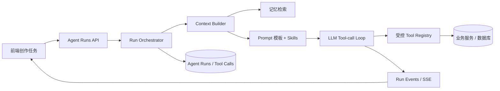

# 墨笺智能创作 Agent 升级方案

## 目标与原则

把当前“每个按钮调用一次模型”的能力升级为一个可控、可观测、可扩展的创作 Agent。Agent 能理解用户任务、读取作品上下文、选择受限工具、组合 Prompt 模板与 Skills，并把生成结果和建议交回用户审核。

升级以渐进式为主：先建设单 Agent 工具循环和确定性工作流，不一开始引入多 Agent、复杂图编排或向量数据库。生成内容默认是草稿；写入作品、修改记忆、合并设定等持久化操作需要用户确认。

## 当前实现基线

- `routers/agent.py` 中的作品字段、大纲、章节规划、章节正文和章节记忆接口分别构造 Prompt 并直接调用 `LLMClient`。
- 章节创作已有“规划 → 正文 → 记忆”的人工串联体验，但这些是独立请求，不是 Agent 自主调用工具的流程。
- 章节正文支持普通响应、SSE 流式输出和 ARQ/Redis 长任务；任务结果持久化在 `generation_jobs`。
- `LLMClient.acompletion()` 已支持 SDK 原始响应，并可透传 `tools` 等参数；`astream()` 当前面向文本片段，不负责解析流式工具调用。
- 章节记忆保存在 `chapters.summary` 与 `chapters.memory`；作品长期记忆保存在 `story_memories`，有来源、审核状态、分类、合并和事件审计。
- 长期记忆检索目前是本地中文短语、关键词、标题和类别加权排序；没有 Embedding 或向量数据库。

## 目标架构

采用“确定性工作流 + 单 Agent 工具循环”的组合。业务关键步骤由服务端状态机约束；Agent 在每个步骤内决定是否调用允许的工具。以后根据评测结果再考虑专职子 Agent。



推荐拆分模块：

```text
agent/
  runtime/       # Agent loop、运行状态、预算、终止条件
  prompts/       # Prompt 注册、版本、渲染和变量校验
  tools/         # Tool 定义、参数模型、权限校验、执行器
  skills/        # Skill 清单、加载器、匹配与版本
  memory/        # 上下文构建、检索、摘要与候选记忆
services/
  agent_runs.py  # Run 创建、恢复、取消、审核和持久化
workers/
  agent_runs.py  # 长任务 Worker（复用 ARQ）
```

现有 `routers/agent.py` 先保留为兼容层，逐个转发到新服务；新架构稳定后再按任务类型拆路由。

## Agent 执行循环

1. 前端提交任务类型、作品/章节 ID、用户目标、可选 Skill 和版本号。服务端验证用户对作品的访问权。
2. Context Builder 只取本次任务所需内容：作品资料、大纲、章节规划、最近章节摘要、审核通过的长期记忆。
3. Prompt Registry 渲染固定系统模板、任务模板、上下文和用户指令；Skill Loader 仅加载明确启用且有权限的 Skill。
4. Runtime 使用 `acompletion()` 请求模型并声明本轮可用的工具。
5. 收到 `tool_calls` 时，校验工具名、JSON 参数、权限、资源归属和调用预算，再执行一个工具或按安全策略并行执行只读工具；结果以 `tool` 消息追加到对话。
6. 继续模型调用，直至得到结构化结果、达到轮数/时间/Token 上限，或需要用户确认。
7. 将状态、进度、工具调用、模型结果和最终草稿写入 Run；SSE 推送事件。写操作以待确认提案返回，不直接执行。

建议默认上限：最多 8 轮模型调用、12 次工具调用、单 Run 60 秒交互时间；章节长文沿用 ARQ 后台任务并允许取消。所有上限做成服务器配置，不接受前端放宽。

## Function Calling 与工具治理

工具定义采用显式注册表，不允许模型提供 Python、SQL、文件路径、Shell 命令或任意 URL。每个工具绑定 Pydantic 参数模型、执行函数、只读/写入属性、权限策略、超时和审计元数据。执行函数调用现有 `crud/` 与 `services/`，不从工具内部调用 HTTP 路由。

第一批建议工具：

| 工具 | 能力 | 权限/副作用 |
| --- | --- | --- |
| `get_project_context` | 读取作品基本信息与大纲 | 只读，校验 user/project 归属 |
| `list_chapters` | 获取章节目录和编号 | 只读，限制返回条数 |
| `get_chapter` | 读取指定章节、规划、摘要 | 只读，检查作品归属及删除状态 |
| `search_story_memory` | 检索审核通过的作品记忆 | 只读，按项目隔离 |
| `draft_chapter_plan` | 生成并校验章节规划 | 只产出提案，不持久化 |
| `draft_chapter_content` | 生成正文草稿 | 长任务走 Worker，不自动覆盖正文 |
| `propose_memory_update` | 提出新增/更新记忆 | 需用户审核后落库 |
| `save_chapter_draft` | 保存章节正文 | 写操作，Run 必须暂停并等待用户确认 |

首版只上只读上下文工具与草稿生成工具。涉及 DB 写入的工具可以先以 `proposal` 事件呈现，确认接口完成后再执行。对工具调用设置参数 Schema、资源范围检查、幂等键、超时、重试策略与速率限制。拒绝未知工具、额外字段及超出用户项目范围的 ID。

## Prompt 模板与版本管理

把散落在路由中的 Prompt 移到代码库内的模板注册表，避免把提示词写成任意可执行模板。每个模板包含 `id`、`version`、适用任务、系统指令、用户模板、输出 Schema、允许工具、默认模型参数和评测样例。模板变量使用 Pydantic 校验后进行安全插值；模板变更通过 Git 审核和版本号发布。

第一批模板：`project_brief`、`novel_outline`、`chapter_plan`、`chapter_content`、`chapter_memory_extract`、`memory_review`。Run 保存实际模板 ID/版本和参数摘要，使生成结果可复现、可比较、可回滚。不要把密钥、完整隐私信息或不必要的全文写入日志。

## Skills 加载方案

Skill 是可组合的领域说明和操作规范，不是可执行插件。每个 Skill 使用 Markdown 正文和受限 YAML frontmatter，字段建议为：`name`、`description`、`version`、`task_types`、`allowed_tools`、`input_schema`、`max_context_tokens`。首批内置 Skills 可包括：长篇大纲策划、章节节奏、人物连续性、悬疑线索管理、中文润色。

加载策略：服务端维护可信 Skill 目录/注册表；按任务类型和用户显式选择进行匹配；每次 Run 记录加载的 Skill 名称与版本；合并到上下文前做大小限制与元数据校验。Skill 内容视为指令数据，不能覆盖系统安全规则、扩大工具权限或触发未授权操作。第一版不从用户任意路径、URL 或仓库外目录动态执行/加载代码。

## 记忆方案演进

保留现有两层数据并明确区分用途：

1. **章节事件记忆（Episodic）**：章节摘要、人物状态、设定变化、未解线索、时间线；对应现有 `chapters.summary/memory`。提取后保留来源章节和生成时间。
2. **作品事实记忆（Semantic）**：经审核的稳定人物设定、世界规则、关系、伏笔和时间事实；对应 `story_memories`。继续采用 pending → approved/rejected 的人工审核。
3. **Run 工作记忆（Working）**：本次任务中临时检索的片段、工具结果和用户补充，只在 Agent Run 内使用，不默认回写长期记忆。

首阶段优化当前检索：增加类别过滤、章节时间范围、来源和命中理由；利用现有关键词/短语排序，并通过召回上限和 Token 预算控制上下文。随后建立一组人工标注的“问题 → 应召回记忆”数据集，测 Precision@K、Recall@K 和正文一致性。只有词法检索达不到目标时，才新增 Embedding 字段/索引并采用“词法 + 向量”混合检索；向量结果仍需项目隔离、审核状态过滤和来源展示。记忆合并、覆写和删除继续留审计事件，撤销记录不能被 Agent 隐式抹除。

## 数据与 API

新增建议：

- `agent_runs`：Run ID、用户/项目/章节、任务类型、状态、输入参数、模板/Skill 版本、结果、错误、Token 用量、创建/结束时间、取消/审批状态。
- `agent_run_events`：有序事件（阶段开始、工具请求、工具结果摘要、进度、审批请求、完成/失败/取消）。避免保存完整敏感 Prompt 和密钥。
- `agent_tool_calls`：Run ID、工具名、校验后的参数摘要、状态、耗时、错误类别、审批关联。按数据保留策略清理。

建议新接口：

- `POST /api/agent/runs`：创建运行；短任务可同步返回 Run，章节正文走队列。
- `GET /api/agent/runs/{run_id}`：读取状态、草稿与用户可见步骤。
- `GET /api/agent/runs/{run_id}/events`：SSE 订阅。
- `POST /api/agent/runs/{run_id}/cancel`：取消运行。
- `POST /api/agent/runs/{run_id}/approve`：批准指定写操作提案。
- `POST /api/agent/runs/{run_id}/reject`：拒绝提案并结束/要求 Agent 调整。

所有 Run 查询都必须按 `user_id` 和项目权限隔离。保留现有 `/api/agent/...` 路由及前端 API，在迁移期间由旧接口适配新 Runtime，避免一次性破坏已有页面。

## 分阶段实施与验收

### 阶段 0：基线与契约

- 固化现有生成能力的输入/输出 Schema、错误语义和回归样例。
- 统一模型配置、Token 预算、错误分类和 Prompt 版本 ID。
- 验收：现有 80+ 后端测试和前端测试保持通过；所有旧接口行为有覆盖。

### 阶段 1：Agent Runtime 与只读工具

- 建工具注册表、参数 Schema、权限上下文和最多 N 轮的 Function Calling loop。
- 用 `acompletion()` 处理原始工具调用；未知工具、非法 JSON、越权资源都安全失败。
- 增加 Run 状态与可观测事件；先运行在内存/现有任务模型上，确认后再增加持久化迁移。
- 验收：MockTransport 测完整多轮工具往返；工具参数与权限测试覆盖；可取消且不会留下假成功状态。

### 阶段 2：Prompt Registry 与 Skills

- 将当前 6 类提示词迁移到版本化模板。
- 加载可信 Skills，支持指定 Skill 与基于任务类型的受限选择。
- 对每次 Run 记录模板/Skill 版本，建立人工评测集比较旧/新输出。
- 验收：模板变量缺失、Skill 越权/超长/恶意指令均被拦截；旧版生成质量不回退。

### 阶段 3：记忆服务整合

- 将章节摘要、长期记忆召回统一封装为 Memory Service，给 Agent 与旧路由共用。
- 输出每条被注入记忆的来源、审核状态和命中原因，便于 UI 检查。
- 加检索评测与成本统计；必要时再做词法/向量混合检索。
- 验收：跨章节连续性用例、当前章节隔离、未审核记忆不召回、项目间隔离全部通过。

### 阶段 4：受控写操作与工作流

- 把“规划 → 正文 → 摘要/记忆候选”实现为服务端确定性状态机；每个阶段可重试、恢复和取消。
- Agent 可提出正文保存、记忆修改等操作，前端展示差异并要求用户确认。
- ARQ 任务恢复按 Run 状态幂等执行，断线后支持查询和续看。
- 验收：重试不重复写入，拒绝后不发生副作用，审批只执行被批准的确切提案。

### 阶段 5：评测与发布

- 增加离线质量集：大纲遵循、章节目标完成、设定一致性、工具选择正确率、记忆召回质量。
- 增加生产指标：成功率、工具失败率、审批拒绝率、延迟、Token 成本、取消率和超时率。
- 按用户/任务类型灰度，新旧流程可切换；保留模板回滚和 Run 审计。

## 安全与运行要求

- Prompt/Skill 内容不可信，始终与系统政策分层；不得让 Skill 定义权限。
- 工具按最小权限暴露；默认只读，写入必须确认；所有对象按当前用户和项目范围重新校验。
- 限制 Agent 轮数、工具次数、并发、输出长度和模型预算；防止递归调用与成本失控。
- 防止提示注入：作品正文、检索记忆和导入内容只能作为引用资料，不可覆盖系统/工具权限。
- 记录足以调试的脱敏事件，不将 API Key、完整认证头或不必要的全文写入日志。
- Provider 不支持 Function Calling 时返回明确能力错误或使用无工具的兼容模板；不能假设所有 OpenAI-compatible 服务都完全兼容工具协议。

## 首个可交付版本建议范围

建议首版只做：版本化 Prompt、可信 Skills loader、3 个只读工具（读作品上下文、章节目录、长期记忆搜索）、章节规划/正文的 Function Calling Runtime、Run 进度事件，以及“保存草稿需用户确认”。沿用现有 LLM 客户端、SQLAlchemy、ARQ/Redis 和记忆表；暂缓多 Agent、任意 Skill 上传、Agent 自主编辑/删除、向量库和模型微调。

这样可以先验证 Agent 是否能正确判断何时检索、如何使用上下文、是否遵循创作规范，再根据数据决定是否增加写工具、向量检索或子 Agent。
